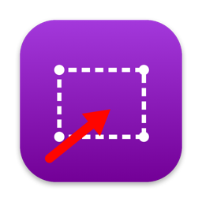

# Inkframe

Screenshot and annotation tool for macOS. Press Cmd+Shift+X, select an area, draw on it in place and press Cmd+C. It works like flameshot, as a native app that runs sandboxed with no network access.

Fork of [ScreenCap](https://github.com/8tp/ScreenCap) by Hunter Meherin (MIT).

## Install

There is no download: a prebuilt app needs a Developer ID signature and notarization, which this project doesn't have. You build it yourself, with Xcode installed and macOS 14 or later.

```bash
git clone https://github.com/gustavoortega/Inkframe.git
cd Inkframe/Inkframe
security find-identity -v -p codesigning
SIGN_IDENTITY="<identity from the list above>" ./scripts/bundle.sh
ditto build/Inkframe.app /Applications/Inkframe.app
open /Applications/Inkframe.app
```

Sign with a stable identity. macOS ties the Screen Recording grant to the signature, so with ad-hoc signing (`SIGN_IDENTITY=-`) every rebuild asks for the permission again. Any Apple ID gets a free Apple Development certificate in Xcode > Settings > Accounts > Manage Certificates.

On the first capture macOS asks for Screen Recording. To start it with your session, turn on "Launch Inkframe at login" in Preferences, from the menu bar icon.

## Use

- Cmd+Shift+X opens the capture on the display you are working on.
- Drag to select, and drag the handles to resize.
- Pick a tool in the toolbar. Right-click a tool to change its color, thickness or font size; the scroll wheel also changes thickness.
- Cmd+C or Enter copies and closes. Cmd+S saves to Downloads. Esc cancels. Cmd+Z and Cmd+Shift+Z undo and redo.
- Pin keeps the capture floating on screen; right-click it to close it.

The menu bar icon keeps ScreenCap's other modes (full screen, window, scrolling capture, recording, OCR). They come from upstream and this fork's tests don't cover them.

## Security

- App Sandbox without the network entitlement, so the app can't open connections.
- Writes only to Downloads or folders you pick. A Cmd+Shift+X capture stays in memory until you copy or save it, and saved files get mode 0600 and never overwrite an existing file.
- It doesn't spawn processes.

A save folder chosen in Preferences is stored as a plain path, which the sandbox doesn't grant again after a relaunch. Downloads always works.

## Develop

```bash
cd Inkframe
swift build
swift test
```

`scripts/make-icon.sh` regenerates the app icon from `scripts/make-icon.swift`.

## License

MIT, see [LICENSE](LICENSE).
